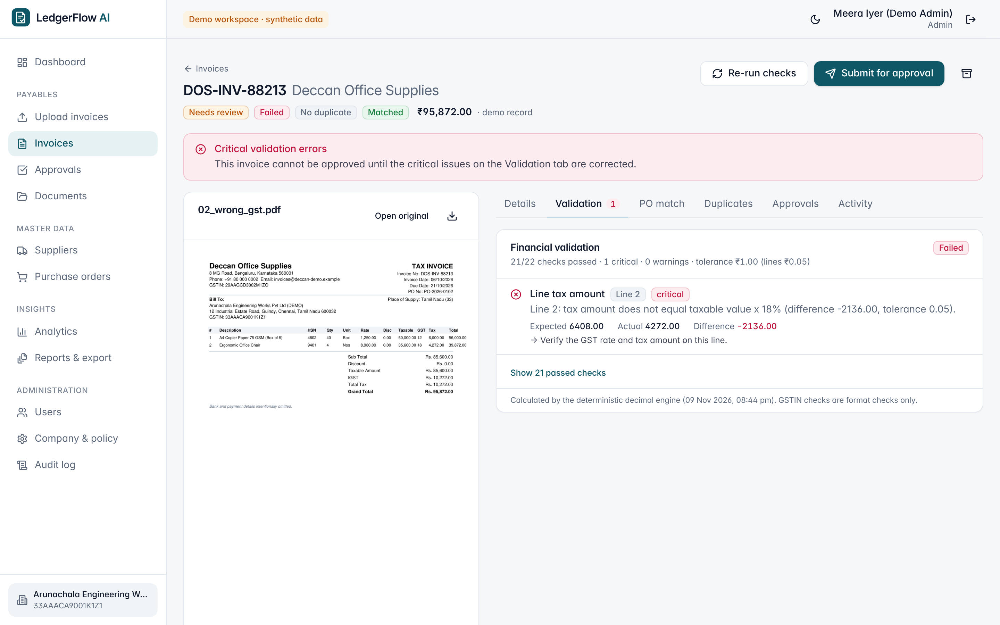
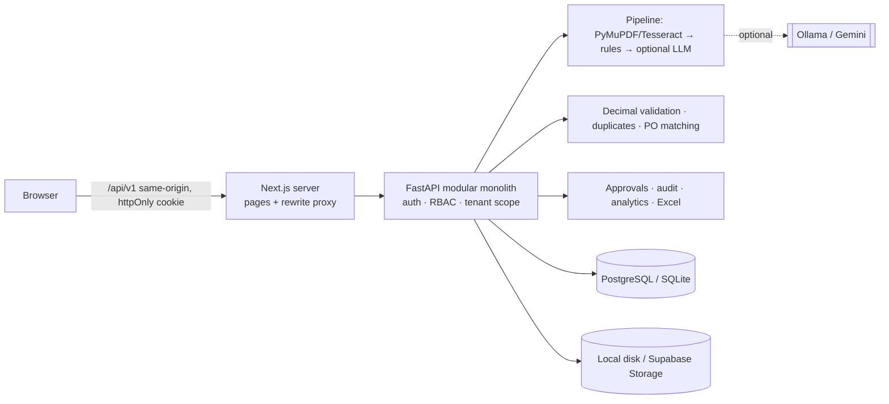
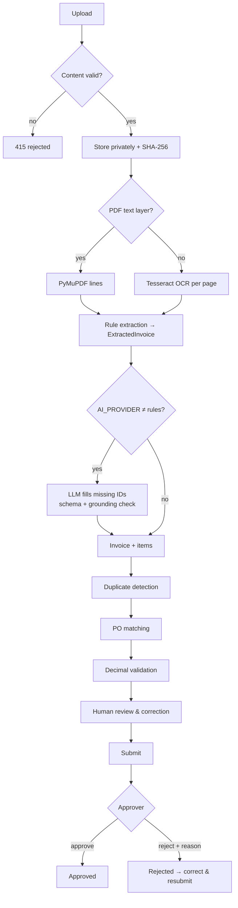
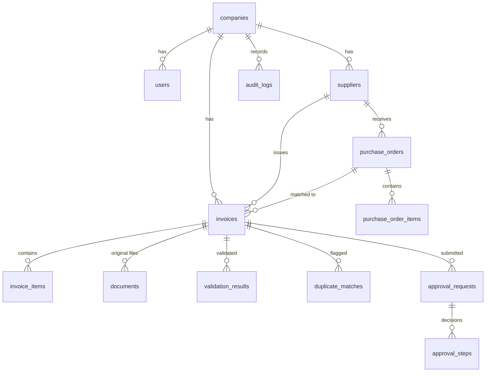
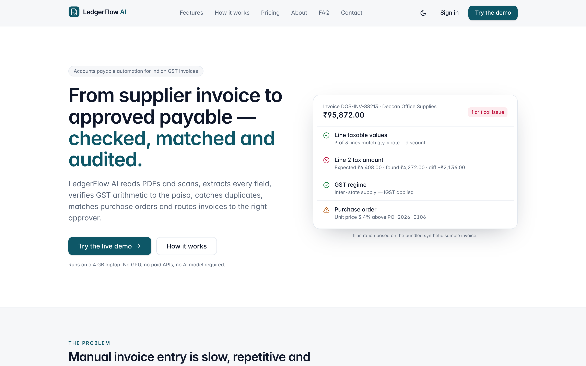
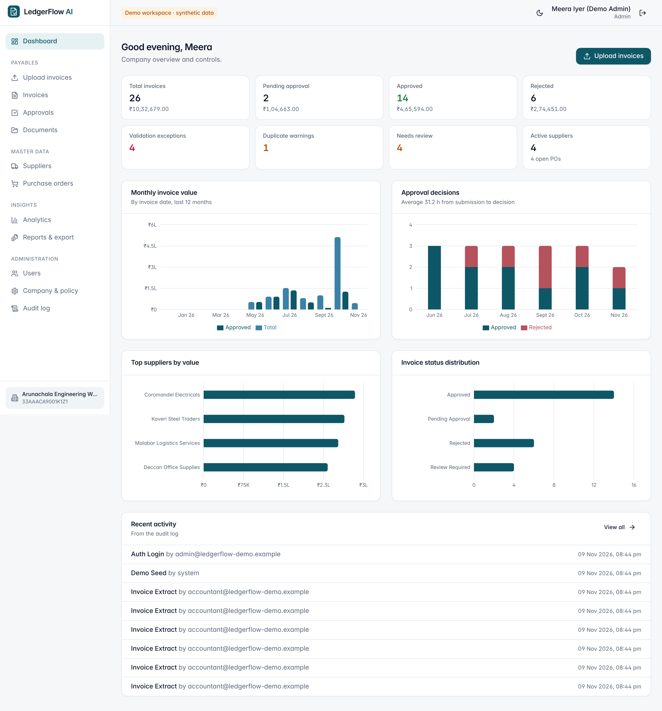
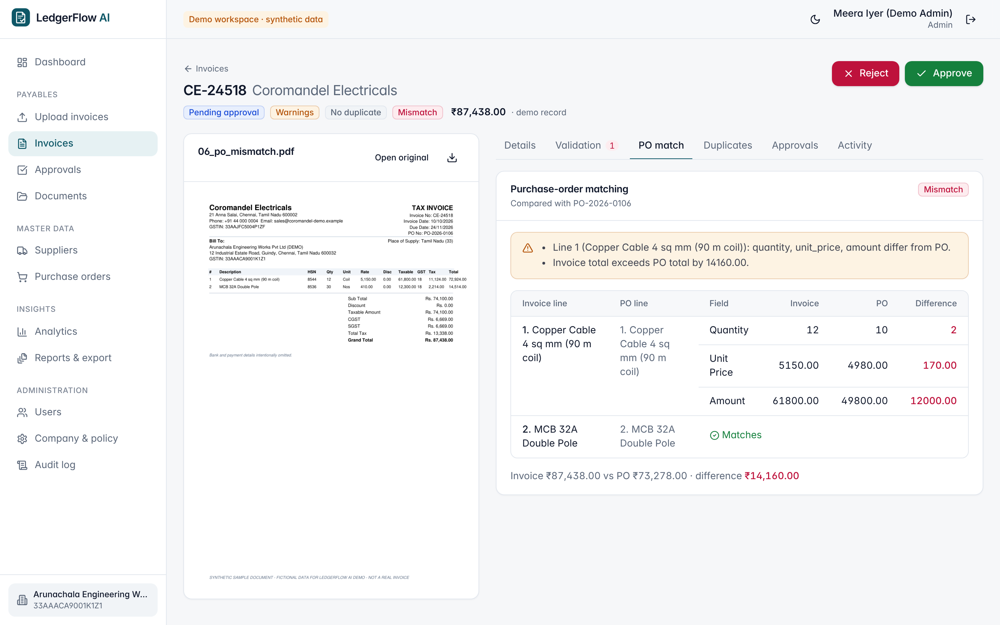
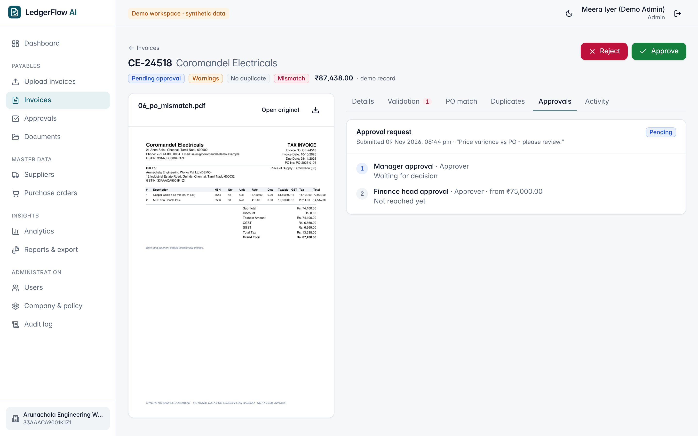
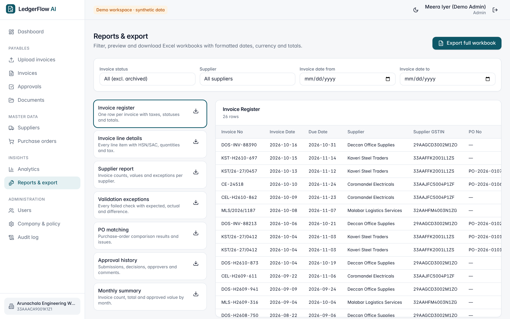
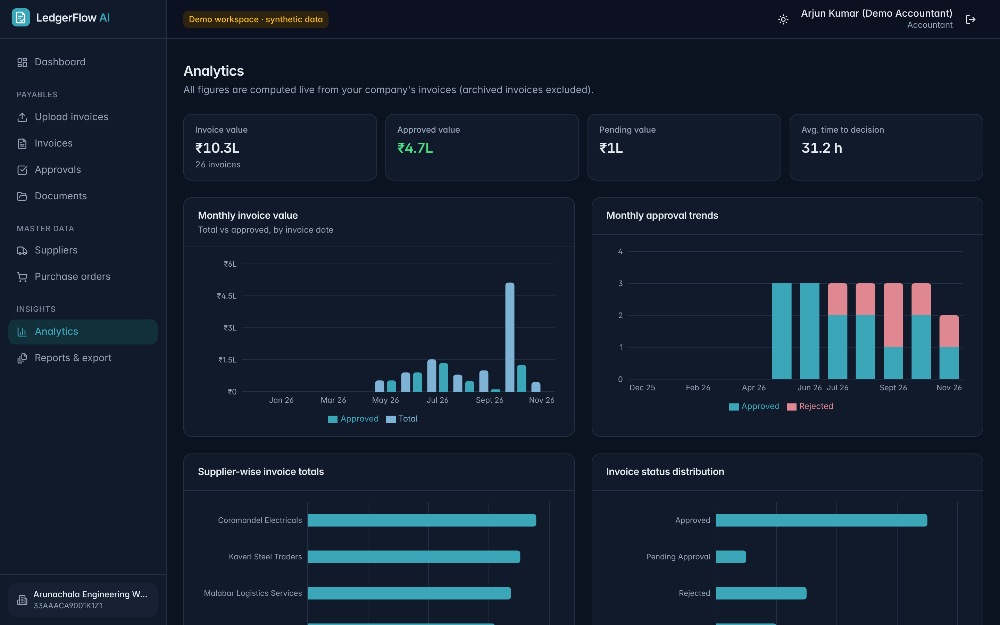

# LedgerFlow AI

**Intelligent Invoice Processing & Business Document Management**

LedgerFlow AI turns supplier invoices (PDF, JPG, PNG) into validated, approval-ready payables. It reads the document with PyMuPDF or Tesseract OCR, extracts structured fields, checks GST arithmetic with exact decimals, flags duplicates, matches purchase orders line by line and routes each invoice through a human approval workflow, with an append-only audit trail.

It runs on a **Windows 11 laptop with 4 GB RAM and no GPU**, costs **₹0**, and needs **no AI model** to work.



---

## Contents
1. [Project overview](#1-project-overview) · 2. [Business problem](#2-business-problem) · 3. [Solution](#3-solution) · 4. [Main features](#4-main-features) · 5. [User roles](#5-user-roles) · 6. [Technology stack](#6-technology-stack) · 7. [Architecture](#7-architecture) · 8. [Data flow](#8-data-flow) · 9. [Database ER diagram](#9-database-er-diagram) · 10. [Installation](#10-installation) · 11. [Windows 11 setup](#11-windows-11-setup) · 12. [Python environment](#12-python-environment) · 13. [Node.js setup](#13-nodejs-setup) · 14. [Tesseract](#14-tesseract-installation-and-configuration) · 15. [Supabase](#15-supabase-configuration) · 16. [SQLite fallback](#16-sqlite-fallback) · 17. [Ollama (optional)](#17-ollama-optional-setup) · 18. [Environment variables](#18-environment-variables) · 19. [Run the frontend](#19-run-the-frontend) · 20. [Run the backend](#20-run-the-backend) · 21. [Seed demo data](#21-seed-demo-data) · 22. [Demo credentials](#22-demo-login-credentials) · 23. [Process an invoice](#23-upload-and-process-an-invoice) · 24. [Run tests](#24-run-tests) · 25. [API documentation](#25-api-documentation) · 26. [Excel export](#26-excel-export) · 27. [Deployment](#27-deployment) · 28. [Free-tier limitations](#28-free-tier-limitations) · 29. [Hardware limitations](#29-hardware-limitations) · 30. [Known limitations & future work](#30-known-limitations-and-future-improvements)

---

## 1. Project overview

| | |
|---|---|
| **What it is** | A multi-company SaaS web app: public website + authenticated workspace for admins, accountants and approvers |
| **Status** | Working MVP with the complete core workflow; see [§30](#30-known-limitations-and-future-improvements) for what is not production-ready |
| **Verified** | 58 backend tests (SQLite **and** PostgreSQL 16), 9 Playwright end-to-end tests, type check, lint and production build. Details in [docs/testing-guide.md](docs/testing-guide.md) |
| **Not verified here** | Live hosting, Docker image builds, real Ollama/Gemini models, running on Windows itself |

## 2. Business problem

Finance teams receive invoices from many suppliers by email and courier. Someone types each one into a spreadsheet or ERP, recalculates CGST/SGST/IGST, looks up the purchase order in another system, then chases approval over email. The work is slow and repetitive, and errors slip through: wrong tax rates, CGST charged on inter-state supplies, arithmetic mistakes, and the same invoice paid twice.

## 3. Solution

One transparent pipeline where software does the reading and arithmetic and people make the decisions:

**Upload → secure storage → text/OCR → field extraction → schema-validated JSON → Decimal validation → duplicate detection → PO matching → human review → approval → audit & analytics.**

Every intermediate result (original file, extracted JSON, validation report, PO comparison, decisions) is stored and inspectable.

## 4. Main features

- **Document intake:** drag-and-drop PDF/JPG/PNG upload with streamed size limits, magic-byte content checks, a full parser check and SHA-256 checksums. Files go to private storage (local or Supabase).
- **Text extraction:** PyMuPDF reads the text layer of digital PDFs (with layout-preserving line reconstruction). Scans and photos go through Tesseract OCR one page at a time, with confidence scores.
- **Field extraction:** rules find the supplier and buyer (name, GSTIN, address), invoice number, dates, PO reference, currency, line items (HSN/SAC, qty, unit, price, discount, taxable, rate, tax, total) and the summary. OCR-aware GSTIN repair applies only where the check digit confirms it. **Unreadable fields are left empty and highlighted, never guessed.**
- **Optional AI:** Ollama (Qwen2.5 0.5B) or Gemini can suggest *missing identifier fields only*. Each suggestion must pass the Pydantic schema and appear verbatim in the document. Any failure falls back to rules.
- **Financial validation:** a deterministic Python `Decimal` engine checks 20+ rules: required fields, dates, GSTIN format and check digit, quantities, line taxable/tax/total, subtotal, discount, taxable total, total GST, grand total, line totals vs header, CGST+SGST vs IGST by state, standard GST slabs, supplier master consistency, and duplicate and PO status. Each check reports **expected, actual, difference, explanation and recommended action**, with configurable tolerances.
- **Duplicate detection:** same supplier and normalised invoice number, same file checksum, or same amount and date. Each match is scored and explained, stored rather than discarded, and resolvable with an audited note.
- **PO matching:** line pairing by HSN and description similarity, then comparison of quantity, price, tax rate and amount within tolerances. Extra, missing and total differences are shown. Statuses: matched, partially matched, mismatch, no PO, requires review.
- **Human review:** side-by-side page preview and editable form (header, parties, line items, summary). Every correction re-runs the checks and is audited as a field-level diff.
- **Approval workflow:** configurable 1–5 levels by amount (default: single level), no self-approval, no approving two levels, mandatory rejection reasons, critical errors block approval, and an optional admin override with written justification (off by default).
- **Master data:** CRUD for suppliers (GSTIN-checked, archive or delete) and purchase orders (line items, server-side Decimal totals, cancel when referenced).
- **Dashboards and analytics:** role-specific dashboards and Recharts charts (monthly value, approval trends, supplier totals, status distribution, validation issues), all from live data.
- **Reports:** seven Excel reports via openpyxl, with filters, currency/date formatting, totals, frozen headers and a JSON preview.
- **Audit log:** append-only (ORM-blocked update/delete), with actor, action, entity, metadata, IP and request id, plus per-invoice activity timelines.
- **Public website:** landing, features, how it works, pricing (presentation only), about, contact (mailto), FAQ, legal, login with demo quick-select, registration, and password recovery.
- **UI:** responsive (no horizontal scroll at 390 px), light and dark themes, loading, empty and error states.

## 5. User roles

| Role | Can |
|---|---|
| **Admin** | Everything: company profile, tolerances, approval policy, users and roles, audit log, delete/archive, plus all accountant and approver actions (but never approve their own submission) |
| **Accountant** | Upload, extract, review and correct, re-run checks, resolve duplicates, manage suppliers and POs, submit for approval, reports |
| **Approver** | View invoices with documents, approve or reject at their level, reports and analytics. Cannot upload, edit or manage master data |

The permission map lives in `backend/app/core/permissions.py` and is enforced on every API route. The UI hides what a role cannot do, but the backend is the authority.

## 6. Technology stack

| Layer | Technology |
|---|---|
| Frontend | Next.js 15 (App Router), React 19, TypeScript, Tailwind CSS 4, shadcn-style components (Radix + cva), Lucide, Recharts, React Hook Form, Zod, Sonner |
| Backend | Python 3.11–3.13, FastAPI, SQLAlchemy 2, Pydantic 2, Alembic, Uvicorn |
| Database | PostgreSQL (Supabase) primary, SQLite fallback |
| Documents | PyMuPDF, Tesseract via pytesseract, Pillow |
| AI | Rule-based (default); optional Ollama `qwen2.5:0.5b-instruct`; optional Gemini |
| Auth | bcrypt + JWT in httpOnly cookies, role-based permissions, token-version revocation |
| Reports | openpyxl |
| Tests | Pytest, FastAPI TestClient, Playwright |

OpenCV is not used: Pillow preprocessing (grayscale, upscale, autocontrast, median filter) was enough for the sample scans, and leaving it out saves memory.

## 7. Architecture



A modular monolith with one backend process and one frontend process: the simplest design that fits 4 GB. The processing function is self-contained so it can move to a background worker later. Full details and design decisions are in [docs/architecture.md](docs/architecture.md).

## 8. Data flow



The sequence diagram and invoice state machine are in [docs/data-flow.md](docs/data-flow.md).

## 9. Database ER diagram

18 tables: `companies`, `company_settings`, `approval_policies`, `users`, `password_reset_tokens`, `suppliers`, `purchase_orders`, `purchase_order_items`, `invoices`, `invoice_items`, `documents`, `processing_records`, `validation_results`, `po_match_results`, `duplicate_matches`, `approval_requests`, `approval_steps`, `audit_logs`.



Full ERD with columns, constraints and indexes: [docs/database-erd.md](docs/database-erd.md). PostgreSQL DDL: [database/schema.sql](database/schema.sql).

## 10. Installation

Prerequisites: **Python 3.11–3.13** (3.12 recommended), **Node.js 20 or 22 LTS**, **Git**, and **Tesseract** (recommended). No Docker, no local PostgreSQL, no Redis.

```text
ledgerflow-ai/
├── backend/          FastAPI app, Alembic migrations, tests
├── frontend/         Next.js app, Playwright e2e
├── database/         schema.sql (PostgreSQL DDL rendered from the migration)
├── docs/             architecture, data flow, ERD, API, security, deployment, guides, screenshots
├── deployment/       optional Dockerfiles, docker-compose, Render blueprint
├── sample-data/      8 synthetic invoices (PDF/PNG/JPG)
└── .env.example
```

## 11. Windows 11 setup

1. **Python:** install 3.12 from [python.org](https://www.python.org/downloads/windows/) and tick *Add python.exe to PATH*.
2. **Node.js:** install the 22 LTS version from [nodejs.org](https://nodejs.org/).
3. **Tesseract:** see [§14](#14-tesseract-installation-and-configuration).
4. Allow local scripts in PowerShell once: `Set-ExecutionPolicy -Scope CurrentUser RemoteSigned`.
5. Open the project folder in PowerShell.

## 12. Python environment

```powershell
cd backend
python -m venv .venv
.venv\Scripts\Activate.ps1
pip install -r requirements-dev.txt     # runtime + pytest + reportlab
copy ..\.env.example ..\.env            # then edit ..\.env (see §18)
```

Generate secrets for `.env`:

```powershell
python -c "import secrets; print(secrets.token_urlsafe(48))"   # run twice: JWT_SECRET, SECRET_KEY
```

## 13. Node.js setup

```powershell
cd frontend
npm install
copy .env.example .env.local
```

## 14. Tesseract installation and configuration

1. Install the Windows build from UB Mannheim: <https://github.com/UB-Mannheim/tesseract/wiki> (English data is included).
2. In `.env`, set `TESSERACT_CMD=C:\Program Files\Tesseract-OCR\tesseract.exe`.
3. Check it: start the backend, sign in as admin and open **Company & policy → System status**. It should show *tesseract · available*.

Without Tesseract, digital PDFs still work fully. Scanned PDFs and images will be marked *Processing failed* with a clear message and can be entered manually. Set `OCR_ENGINE=none` to disable OCR explicitly.

## 15. Supabase configuration

1. Create a free project at [supabase.com](https://supabase.com).
2. Copy **Project Settings → Database → Connection string (URI)** into `DATABASE_URL` in `.env`.
3. Run `alembic upgrade head` from `backend/`.
4. For hosted document storage, create a **private** bucket `ledgerflow-documents`, then set `STORAGE_PROVIDER=supabase`, `SUPABASE_URL` and `SUPABASE_SERVICE_ROLE_KEY`. The service-role key stays in the backend `.env` only.

Keep the database private: LedgerFlow enforces tenant isolation in the API, not with Row Level Security. Free projects pause after a week of inactivity ([docs/free-resource-guide.md](docs/free-resource-guide.md)).

## 16. SQLite fallback

Leave `DATABASE_URL` empty. The backend uses `backend/ledgerflow.db` with foreign keys enforced and money stored as exact text. The same models, migrations and tests run on both databases. All 58 tests were executed on SQLite and on PostgreSQL 16.

## 17. Ollama (optional) setup

```powershell
winget install Ollama.Ollama
ollama pull qwen2.5:0.5b-instruct
```

In `.env`: `AI_PROVIDER=ollama` (keep `OLLAMA_NUM_CTX=1024`). The app starts and works without Ollama. If the model is missing, slow, out of memory or returns bad JSON, extraction falls back to rules and the invoice notes record it. **The model was not run in this build; only the integration was tested, against a mocked API.** Read [docs/hardware-limitations.md](docs/hardware-limitations.md) before enabling it on 4 GB.

## 18. Environment variables

Templates: [.env.example](.env.example) (backend, all server-side) and [frontend/.env.example](frontend/.env.example). The full reference with defaults is in [docs/environment.md](docs/environment.md).

Minimum for local use: `JWT_SECRET`, `SECRET_KEY` (`.env`), and `TESSERACT_CMD` on Windows. Everything else has a safe default. Secrets (`JWT_SECRET`, `SECRET_KEY`, `SUPABASE_SERVICE_ROLE_KEY`, `GEMINI_API_KEY`, `DATABASE_URL`) are never read by the frontend.

## 19. Run the frontend

```powershell
cd frontend
npm run build      # once, or after code changes
npm start          # http://localhost:3000  (~230 MB RAM; recommended on 4 GB)
# while editing UI code instead:  npm run dev   (~900 MB RAM)
```

The frontend proxies `/api/v1/*` to `BACKEND_URL` (default `http://127.0.0.1:8000`).

## 20. Run the backend

```powershell
cd backend
.venv\Scripts\Activate.ps1
alembic upgrade head                                   # first run / after pulling migrations
uvicorn app.main:app --host 127.0.0.1 --port 8000      # one process, ~220 MB RAM
```

Swagger UI: <http://127.0.0.1:8000/api/docs> · Health: `/api/v1/health`.

## 21. Seed demo data

```powershell
cd backend
python -m app.demo.seed --reset     # SQLite: recreates the DB, then seeds
python -m app.demo.seed             # PostgreSQL/Supabase: seeds a migrated, empty database
```

This creates a clearly labelled demo company with 4 users, 4 suppliers, 4 purchase orders, 18 historical invoices for the charts, and the **8 synthetic scenario documents processed by the real pipeline** (not fixtures):

| # | Scenario | Result after processing |
|---|---|---|
| 01 | Valid invoice, intra-state, PO matched | Validation passed, then approved |
| 02 | Wrong GST on one line (12% charged, 18% stated) | Critical: expected ₹6,408, actual ₹4,272 |
| 03 | Grand total overstated by ₹500 | Critical arithmetic errors, then rejected with a reason |
| 04 | Scanned PNG with no number, date or buyer GSTIN | OCR; fields left empty and highlighted |
| 05 | Duplicate of 01 | Exact duplicate; submission blocked |
| 06 | Price 3.4% above PO, 12 coils vs 10 | PO mismatch; pending two-level approval |
| 07 | Two items not on the PO | Partially matched; pending approval |
| 08 | Skewed, noisy JPEG scan | OCR; unreadable buyer GSTIN flagged for review |

All names, GSTINs and documents are fictional (GSTINs are generated with valid check digits from made-up PANs).

## 22. Demo login credentials

Password for every demo account: **`LedgerFlow2026`**. The login page has one-click buttons for each.

| Role | Email |
|---|---|
| Admin | `admin@ledgerflow-demo.example` |
| Accountant | `accountant@ledgerflow-demo.example` |
| Approver (level 1) | `approver@ledgerflow-demo.example` |
| Approver (level 2, invoices ≥ ₹75,000) | `finance.head@ledgerflow-demo.example` |

These exist only in the seeded demo company. Do not seed them into a client database. Hide the buttons with `NEXT_PUBLIC_DEMO_MODE=false`.

## 23. Upload and process an invoice

1. Sign in as **Accountant** → **Upload invoices** → drop a file from `sample-data/synthetic-invoices/`.
2. Each file is uploaded, read (PDF text or OCR), extracted and checked; the row shows its statuses. Click **Review**.
3. Compare the page preview with the **Details** form. Highlighted fields need attention. Fix them and click **Save corrections** (checks re-run and the change is audited).
4. Look at the **Validation**, **PO match** and **Duplicates** tabs. Resolve or correct as needed.
5. Click **Submit for approval**.
6. Sign in as **Approver** → **Approvals** → **Review** → **Approve**, or **Reject** with a reason.
7. The dashboards, analytics, Excel reports and **Audit log** (admin) reflect the result.

## 24. Run tests

```powershell
cd backend; pytest                               # 58 tests, SQLite, no network
cd ..\frontend; npm run typecheck; npm run lint; npm run build
npx playwright install chromium; npm run test:e2e   # needs both servers + fresh seed
```

See [docs/testing-guide.md](docs/testing-guide.md) for what each suite covers and the results recorded in this build.

## 25. API documentation

57 operations under `/api/v1`: auth, company and users, suppliers, purchase orders, documents (upload, download, preview), invoices (CRUD, extract, validate, match PO, resolve duplicate, submit, approve, reject), approvals, analytics, reports and audit logs. See [docs/api-documentation.md](docs/api-documentation.md) for conventions, error codes, the permission matrix and every endpoint, and `/api/docs` for interactive Swagger.

## 26. Excel export

**Reports & export** offers: Invoice register, Invoice line details, Supplier report, Validation exceptions, PO matching, Approval history and Monthly summary. You can filter by status, supplier and date range, preview in the browser, and download a single sheet or the full workbook. Workbooks have titled sheets, frozen headers, ₹ number formats, date formats, fitted column widths and `SUM` total rows. Exports are recorded in the audit log. The invoice list also has a one-click **Export Excel** using its current filters.

## 27. Deployment

Free-tier path: **Vercel Hobby** (frontend) → **Render Free, Docker** (backend with Tesseract) → **Supabase Free** (PostgreSQL + private Storage). Step-by-step instructions and a pre-deployment checklist are in [docs/deployment.md](docs/deployment.md), with Dockerfiles, docker-compose and `render.yaml` in [deployment/](deployment/).

**No live deployment was created in this build**, and the Docker images were not built (the sandbox had no network inside build containers). No live URL is claimed.

## 28. Free-tier limitations

Checked against the providers' official pages on 9 Nov 2026 ([docs/free-resource-guide.md](docs/free-resource-guide.md)):

- **Render Free:** spins down after 15 idle minutes (about a minute to wake), has an **ephemeral filesystem**, and free Postgres expires after 30 days. Use Supabase for both the database and files.
- **Supabase Free:** 500 MB database, 1 GB storage, 50 MB max upload, **paused after 1 week of inactivity**, no automatic backups.
- **Vercel Hobby:** personal, **non-commercial** use only.
- **Gemini free tier:** quota-limited, with data-use terms that differ from paid tiers. LedgerFlow never sends documents unless cloud AI is explicitly enabled.

A free-tier deployment is a demo, not a production system.

## 29. Hardware limitations

Measured in the build sandbox (Linux; re-measure on Windows): backend about 218 MB, Tesseract about 43 MB per page, production frontend about 227 MB, dev frontend about 900 MB. A digital PDF processes in about 0.04 s and a scanned page in about 0.8–1.4 s. On 4 GB, use `npm start` rather than `npm run dev`, SQLite or Supabase rather than local PostgreSQL or Docker, and `AI_PROVIDER=rules`. The 0.5B model was not measured. See [docs/hardware-limitations.md](docs/hardware-limitations.md).

## 30. Known limitations and future improvements

**Limitations (honest):**
- Rule-based extraction is tuned for common Indian GST invoice layouts and verified on the bundled synthetic samples. Real supplier layouts will need per-supplier templates or tuning; plan a pilot with real documents.
- GSTIN checks are offline format and check-digit checks, not GST Network verification.
- Password-reset emails are not sent (no email provider). The dev-mode link is shown on screen only in development.
- Supabase Auth, MFA and SSO are not integrated. Authentication is LedgerFlow's own bcrypt/JWT.
- Processing is synchronous, one document per request. The rate limiter is per process.
- Audit immutability is enforced by the application, not database permissions. Uploads are not malware-scanned. There is no CSP header yet.
- No live deployment; Docker images not built; real LLMs not exercised; not run on Windows in this build.

**Next steps:** email ingestion (IMAP/Gmail), batch processing with a background worker, supplier-specific extraction templates with accuracy metrics, Tally/Zoho Books/ERP export, GST portal verification through a licensed GSP, payment scheduling and three-way match (GRN), document retention policies, Supabase Auth with MFA, usage quotas and billing, and Sentry/OpenTelemetry observability.

A full technical and commercial review is in [docs/project-review.md](docs/project-review.md).

---

### Screenshots

| | |
|---|---|
|  |  |
|  |  |
|  |  |

More in [docs/screenshots/](docs/screenshots/).

### Demo video (suggested 4-minute script)

1. Landing page: problem and workflow (20 s).
2. Accountant: upload `02_wrong_gst.pdf`; show the duplicate warning, the critical line-tax error with expected/actual/difference, and the preview (60 s).
3. Open the untitled Coromandel invoice (scanned `04_missing_fields.png`): highlighted empty fields, type an invoice number and date, save, submit (60 s).
4. Approver: queue, PO-mismatch tab, approve level 1; Finance head approves level 2; reject another with a reason (60 s).
5. Admin: dashboard charts update, audit log entries, Excel export, approval policy (40 s).

Record with the Windows Snipping Tool (Win + Shift + R) or OBS Studio, both free.

### License

Portfolio project. Add a license (for example MIT) before publishing.
