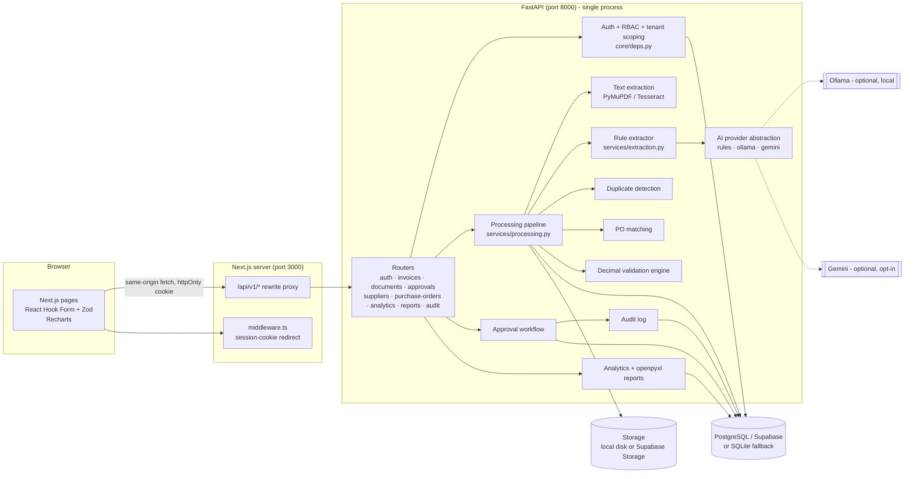

# Architecture

LedgerFlow AI is a **modular monolith**: one FastAPI backend process and one Next.js frontend process. That is the simplest shape that meets the requirements, it fits a 4 GB laptop, and every module has a clean boundary that can later move behind a queue or into its own service.



## Key decisions

| Decision | Why | Trade-off / path to scale |
|---|---|---|
| Modular monolith, synchronous pipeline | One process each for API and UI keeps RAM low; no Redis/Celery to install | Long batches block one request. `process_document()` is self-contained, so it can move to a worker (RQ/Celery/Cloud Tasks) unchanged |
| Rules first, AI optional | Works with no model or GPU; deterministic and testable | Unusual layouts need manual correction. Supplier-specific templates are the next improvement |
| LLM may only fill missing *identifier* fields, and only if the value literally appears in the text | Prevents hallucinated values; a 0.5B model is not reliable for numbers | Less AI "magic", but no invented financial data |
| Decimal everywhere; `Money` column type | Exact arithmetic; SQLite stores money as TEXT to avoid float drift | SQL aggregates on SQLite need casting (handled by `money_sort`) |
| Same-origin proxy (Next.js rewrites) + httpOnly cookie | No tokens in JS, no CORS for the browser, backend URL never shipped to the client | One extra hop. API clients can still use Bearer tokens |
| Tenant derived from the authenticated user | A client-supplied company ID can never widen access | All new queries must use `get_owned()` or filter on `company_id` (enforced by tests) |
| Duplicates are flagged, not rejected by a unique constraint | Requirement: never silently discard a document | Exact duplicates are blocked at *submission* instead |
| Append-only audit table with ORM guards | Audit integrity through normal interfaces | A DB superuser can still alter rows. Add DB-level `REVOKE UPDATE, DELETE` or WORM storage for production |
| Local JWT auth on both SQLite and PostgreSQL | One code path, works offline, no external dependency | Supabase Auth (SSO, email flows) is listed as a future integration, not implemented |

## Backend layout

```
backend/app
├── core/        config, database (Money type), security (bcrypt, JWT), deps (auth/RBAC/tenant), errors, rate limit, logging
├── models/      SQLAlchemy models (18 tables)
├── schemas/     Pydantic request/response + extraction schemas
├── services/    gst, money, text_extraction, extraction, validation, duplicates, po_matching,
│                invoices (orchestration), processing (pipeline), approvals, analytics, reports, storage, audit
├── ml/          providers.py - rules / Ollama / Gemini with fallback and grounding
├── api/         FastAPI routers (57 operations under /api/v1)
├── demo/        synthetic scenarios, document generator, seed script
└── main.py
```

## Frontend layout

```
frontend/
├── app/(marketing)/   landing, features, how-it-works, pricing, about, contact, faq, legal
├── app/(auth)/        login (demo quick-select), register, forgot/reset password
├── app/app/           protected workspace: dashboard, invoices (list/upload/review/new), approvals,
│                      documents, suppliers, purchase-orders, analytics, reports, admin/{users,settings,audit}
├── components/ui/     shadcn-style primitives (Radix + cva + tailwind-merge), written in-repo
├── components/app/    shell, invoice form, review panels, charts, PO form
├── lib/               api client, session context, types, hooks
└── e2e/               Playwright tests
```

The UI components follow shadcn/ui conventions (Radix primitives, `cva` variants, `cn()` helper) but were written directly in the repository instead of being pulled with the shadcn CLI.

## Request lifecycle

1. The browser calls `/api/v1/...` on the Next.js origin. `next.config.ts` rewrites it to `BACKEND_URL`.
2. `RequestContextMiddleware` assigns an `X-Request-ID` and logs method, path, status, latency and user id (never bodies or tokens).
3. `get_current_user` validates the JWT (signature, expiry, issuer) and the user's `token_version` and active flag.
4. `require("<permission>")` checks the role-permission map in `core/permissions.py`.
5. Handlers load records through `get_owned(db, Model, id, current.company_id)`.
6. State changes write an `audit_logs` row in the same transaction.
7. Errors are converted to the standard envelope. Unexpected exceptions are logged with the request id and returned as a generic 500.
