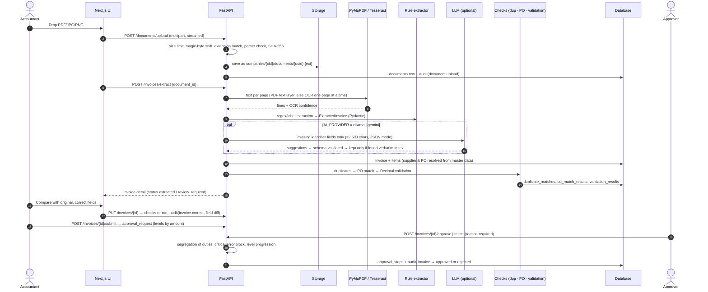
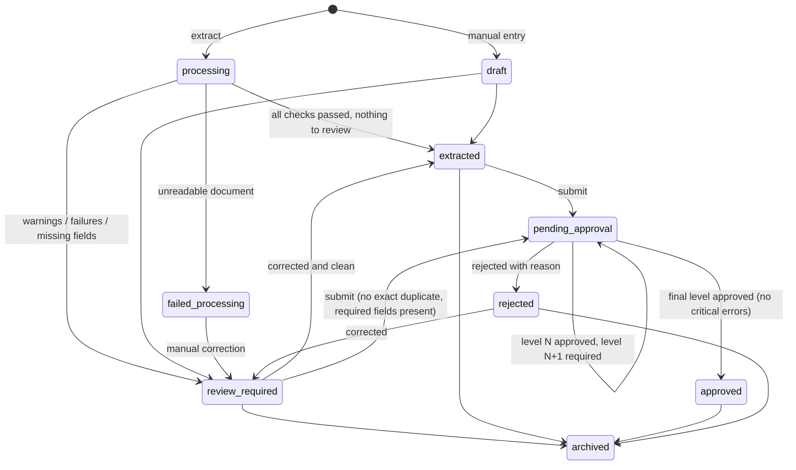

# Data flow

## Document → approved invoice

## Invoice lifecycle

Each invoice also carries three independent statuses shown as badges:

- `validation_status`: `not_run`, `passed`, `warnings` or `failed`. `has_critical_errors` blocks approval.
- `duplicate_status`: `none`, `possible_duplicate`, `duplicate` or `resolved_not_duplicate`. An exact duplicate blocks submission.
- `po_match_status`: `not_run`, `matched`, `partially_matched`, `mismatch`, `no_po_found` or `requires_review`.

## What is stored

| Artefact | Where | Mutable? |
|---|---|---|
| Original file | Storage (`storage_key`), metadata in `documents` | No (delete is admin-only and blocked for pending/approved invoices) |
| OCR/PDF text | `processing_records.raw_text` (≤50k chars) | No |
| Extraction snapshot | `invoices.extracted_data` (JSON) | No; corrections go to invoice columns |
| Current invoice values | `invoices`, `invoice_items` | Yes, while editable; every change is audited |
| Validation / PO / duplicate results | `validation_results`, `po_match_results`, `duplicate_matches` (history kept) | Append-only history |
| Decisions | `approval_requests`, `approval_steps` | Steps are append-only |
| Audit trail | `audit_logs` | Append-only (ORM blocks update/delete) |
