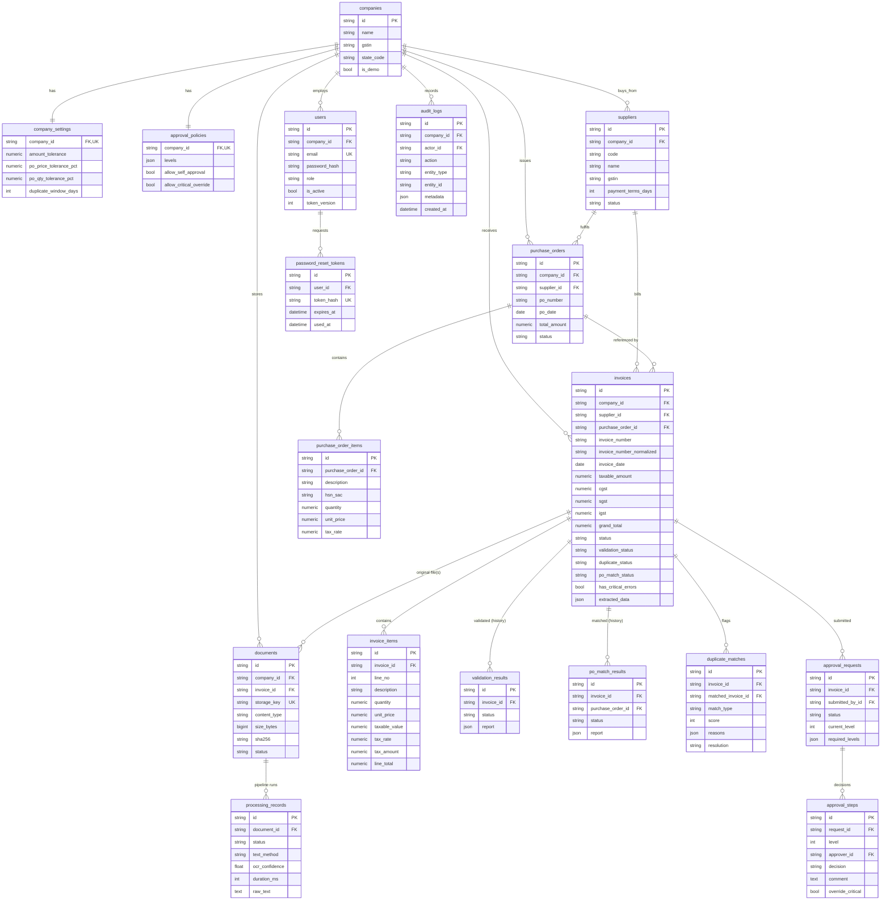

# Database design (ERD)

Schema is managed by **Alembic** (`backend/alembic/versions/0001_initial_schema.py`). `database/schema.sql` is the same migration rendered as PostgreSQL DDL for review. All primary keys are UUID strings, so data is portable between SQLite and PostgreSQL.



## Constraints and indexes

| Rule | Implementation |
|---|---|
| One account per email | `uq_users_email` |
| Supplier code unique per company | `uq_supplier_company_code` |
| PO number unique per company | `uq_po_company_number` |
| Storage key unique | `documents.storage_key` UNIQUE |
| Fast duplicate lookups | `ix_invoice_dup_lookup (company_id, supplier_id, invoice_number_normalized)` + `documents.sha256` index |
| Fast dashboard filters | `ix_invoice_company_status`, `ix_invoice_company_date`, `ix_audit_company_created` |
| Referential integrity | Foreign keys everywhere; `ON DELETE CASCADE` from company; SQLite runs with `PRAGMA foreign_keys=ON` |
| Money precision | `NUMERIC(18,2)` (quantities `NUMERIC(18,3)`) on PostgreSQL; exact TEXT on SQLite via the `Money` type |
| Timestamps | `TIMESTAMPTZ`, always UTC (`UTCDateTime` type guarantees tz-aware values on SQLite too) |

Invoice-number uniqueness is deliberately **not** a database constraint: duplicates must be stored and shown to a person, not rejected at upload.

## Migrations

```bash
cd backend
alembic upgrade head                 # apply
alembic downgrade -1                 # roll back one revision
alembic revision --autogenerate -m "describe change"   # after editing models; review the file before committing
alembic check                        # fails if models and migrations differ
```

Verified in this build: `upgrade`, `downgrade base` and `check` on both SQLite and PostgreSQL 16.

## Row-level security note

Tenant isolation is enforced in the API layer, and the backend connects with a single database role. If you expose the Supabase database directly to clients (e.g. via PostgREST), you **must** enable Row Level Security policies on every table first. LedgerFlow does not need that exposure, so keep the database private.
